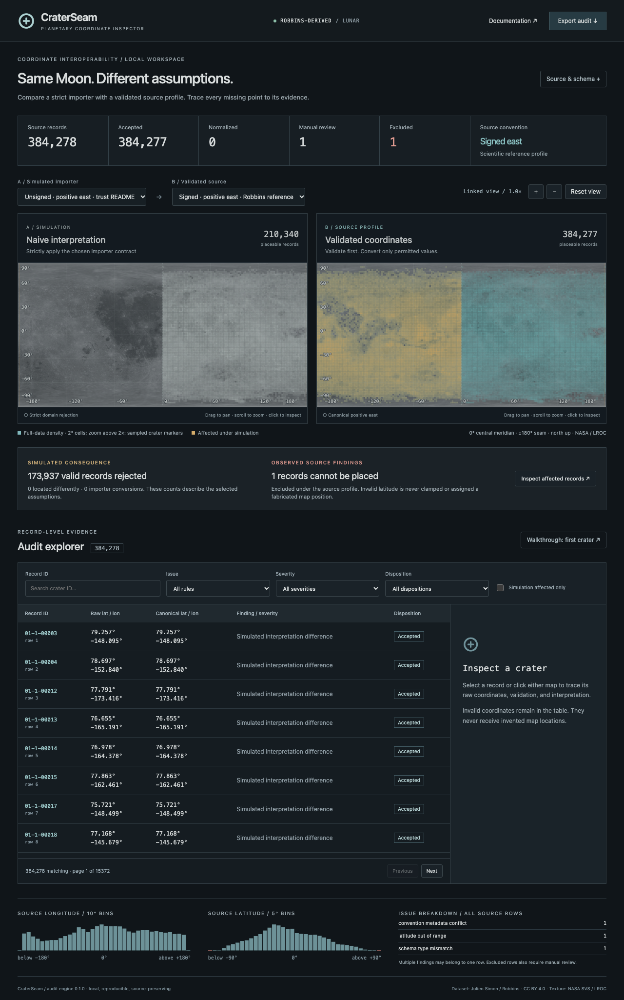

# CraterSeam

[](https://github.com/ranajahanzaib/crater-seam/actions/workflows/ci.yml) [](LICENSE)

A local planetary coordinate debugger, built with Rust, Axum, React and Canvas. Load Parquet or CSV, audit the original values, simulate a strict importer, inspect every finding, and export a reproducible report. No accounts, paid services, database, or deployment required.



## Why this dataset?

Planetary longitude has two independent choices: signed versus unsigned domain, and positive east versus positive west. A valid coordinate can disappear under an incompatible importer contract, or be mirrored under a different direction assumption. Numeric ranges cannot establish east versus west.

The [Hugging Face Robbins-derived dataset](https://huggingface.co/datasets/juliensimon/lunar-craters-robbins) documents unsigned east longitude and integer identifiers. Its actual Parquet file contains signed longitudes and string identifiers. [Robbins (2019), Table 1](https://doi.org/10.1029/2018JE005592) specifies signed, positive-east longitude. CraterSeam exposes those disagreements instead of silently repairing the source.

## Measured findings

Acquired November 2, 2026, revision `a6d08bfde1273a5e92fa34dbd584eafb6d667e8b`:

| Measurement                                                       |          Actual result |
| ----------------------------------------------------------------- | ---------------------: |
| Source records                                                    |                384,278 |
| Placeable under the scientific signed-east profile                |                384,277 |
| Physically invalid latitude                                       |                      1 |
| Missing, malformed, or nonfinite coordinates                      |                      0 |
| Duplicate IDs                                                     |                      0 |
| Valid records rejected by the README-based unsigned-east importer |                173,937 |
| Included by that simulated importer                               |                210,340 |
| Source longitude range                                            | −179.997° to +179.998° |
| Source latitude range                                             |  −105.383° to +85.576° |
| Normalization applied under signed east                           |                      0 |

Crater `12-1-09489`, source row 284,838, has latitude −105.383° and longitude 88.993°. It is retained in reports and excluded from maps without clamping. This is an observation about the **derived file**, not evidence that the original Robbins catalog contains the same defect. The two dataset-level discrepancies are the longitude-domain claim and `crater_id` type (`BYTE_ARRAY`, logical string, rather than `INT64`). The dataset card declares planetocentric latitude; the default profile preserves that explicit metadata.

See [provenance and full schema](docs/data-provenance.md) and the small, checked-in [measured summary](docs/observed-audit.json). Findings are computed at runtime; the UI does not use those documentation snapshots as data.

## Run locally

Requirements: Rust stable (edition 2024; tested with Rust 1.99.1), Node.js 22.12+ and pnpm 12.3.4, and curl for the optional basemap script. Runs on Apple Silicon macOS; CI also targets Linux. Initial dependency and data downloads require internet access. Runtime uses local files only.

```sh
cargo build --locked
cargo run -- fetch --source robbins
./scripts/fetch-basemap.sh
pnpm --dir web install --frozen-lockfile
pnpm --dir web build
cargo run -- serve --input data/lunar_craters.parquet --port 8787
```

Open **http://127.0.0.1:8787**. The server binds only to loopback. It audits all rows at startup for four explicit source assumptions and shares the immutable raw records between them. Initial startup takes several seconds in a debug build. The NASA texture is included locally; if absent, the graticule remains functional with a visible fallback notice.

For frontend development, keep the Rust API running and run `pnpm --dir web dev`; Vite proxies `/api` to port 8787. For faster processing, substitute `cargo run --release -- ...`.

## CLI

```sh
# Revision-pinned fetch; writes a SHA-256-verified provenance sidecar and dataset card
cargo run -- fetch --source robbins

# JSON report, flagged CSV, normalized CSV, summary, and candidate baseline
cargo run -- audit \
  --input data/lunar_craters.parquet \
  --profile profiles/robbins.json --output artifacts

# Known defects pass; new critical problems fail (exit code 2)
cargo run -- check \
  --input data/lunar_craters.parquet --profile profiles/robbins.json \
  --baseline tests/baselines/robbins.json

cargo run -- --help
cargo run -- --version
```

Execution or input errors exit 1. Audit reports dirty data successfully; `check` applies the regression policy. Paths resolve relative to the current working directory. Run examples from the repository root.

CSV column selection is explicit in a JSON profile. Copy `profiles/robbins.json`, set `id_column`, `latitude_column`, `longitude_column`, and optionally `diameter_column` / `depth_column` (or null). Set `domain` to `signed` or `unsigned`, `direction` to `east`, `west`, or `unknown`, and `latitude_type` to `planetocentric`, `unconfirmed`, or `planetographic`. Set `documentation` to null for unrelated data, and explain the choice in `evidence`.

```sh
cargo run -- audit --input tests/fixtures/coordinates.csv \
  --profile profiles/robbins.json --output artifacts/fixture
```

CSV text is preserved as text; malformed numeric coordinate cells produce findings rather than stopping the audit. Optional missing depth is not a coordinate problem. Missing IDs receive stable `row:N` identifiers. Repeated IDs retain each occurrence, addressable by `source_row`. Structurally corrupt files and CSV rows with excess unheaded fields produce useful errors rather than silently losing values.

## Reading the maps

1. Start with **unsigned positive east / trust README** on the left and **signed positive east / Robbins reference** on the right.
2. The empty western half on the left is a simulated importer consequence. Its negative longitudes are valid under the scientific source profile.
3. Amber cells on the validated map contain records affected by the simulation. All density counts use the complete filtered dataset, with 2° cells. Cells are aggregates, not invented crater positions.
4. Zoom beyond 2× to see up to 3,000 deterministic, viewport-filtered real markers per map. The density layer still includes all filtered records. Pan and zoom are linked; reset returns both maps to global extent.
5. Click a map or select a table row. The selected point is highlighted wherever placeable. Search and all record filters apply to both maps and the server-paginated table.
6. Try the first-crater walkthrough: `01-1-00003`, latitude 79.257°, longitude −148.095°. Source and canonical numbers are identical. It did **not move**; the naive unsigned importer omitted it.
7. Select signed positive west for the importer to examine mirrored interpretations. This is an explicit hypothetical assumption, not a new defect attributed to the source.
8. Open Source & schema for documentation claims, physical types, observed ranges, scientific evidence, hash and revision. Dataset-level findings are separate from row filters.

Canonical output uses positive-east longitude in `[-180,180)`; latitude is preserved in `[-90,90]`. Domain validation occurs **before** direction conversion and wrapping. +180 and −180 denote the same seam; 360 in an unsigned profile becomes 0. Invalid latitudes are never clamped. Unknown direction prevents safe placement. Planetographic-to-planetocentric conversion is rejected without a body model. Unconfirmed latitude metadata is preserved and flagged, not silently certified.

## Exports and reproducibility

The export menu downloads the full audit under the selected **source** profile; table filters and the hypothetical importer do not redefine the source audit.

- `audit.json`: input hash, acquisition/revision provenance when available, physical schema/null counts, engine version, explicit profile, summary/rule definitions, dataset findings, and every original row with parsed and normalized values.
- `flagged.csv`: every row with a record finding, original coordinate values, canonical values where safe, rule IDs, severity and disposition. Dataset-level discrepancies appear in JSON, not as fabricated crater rows.
- `normalized.csv`: every safely placeable record (including duplicate IDs requiring review), all source columns in stable order, explicit `craterseam_canonical_*` columns, source row, serialized input profile, output convention and excluded count. Source fields are never overwritten. Excluded rows are omitted only from this explicitly normalized export and remain in the full audit.

Serialization is deterministic for the same input, profile and provenance sidecar. A sidecar is trusted only when its SHA-256 matches the input; otherwise provenance is recorded as unknown. The source file is never modified by audit or check. Raw data and large generated reports are ignored by Git.

## Regression policy

The checked-in real-data baseline records the **known** invalid latitude and metadata discrepancies. Checks fail on new critical evidence, critical rule-count increases beyond the allowance, profile/engine changes, or removed/changed schema columns. Warnings and resolved findings are reported. For records with source IDs, row reordering alone does not introduce a new defect. Row-derived fallback identifiers cannot preserve identity across arbitrary reorderings. Evidence identifiers use record ID, rule, original value and explanation; duplicate occurrence counts are additionally checked.

The default allowance is zero. `--max-new-critical N` permits a reviewed threshold; it does not suppress reporting. To accept a new baseline, generate an audit in a fresh output directory, inspect the comparison and original evidence, then **explicitly copy** its candidate `baseline.json` into the approved baseline path in a reviewed change. `check` never updates a baseline.

The [GitHub Actions workflow](.github/workflows/ci.yml) runs Rust/React checks, fetches the pinned dataset revision, compares the baseline and runs browser tests. It is provided as repository configuration; local validation is not a claim that hosted Actions has run.

## Tests

```sh
cargo fmt --all --check
cargo clippy --all-targets -- -D warnings
cargo test
pnpm --dir web test
pnpm --dir web build
# Start the Rust server as above, then:
pnpm --dir web exec playwright install chromium
pnpm --dir web test:e2e
node tests/integration/verify-real.mjs
```

If your shell selects a different `rustdoc` than `rustc`, run `RUSTDOC="$(rustup which rustdoc)" cargo test`. This host had an older `/usr/local/bin/rustdoc`; no tests are disabled to work around it.

Tests cover strict coordinate domains, all supported direction/domain combinations, exact boundaries, near-seam values, negative zero, nonfinite/missing/malformed cells, impossible latitude, poles, multiple findings, duplicate IDs, exports, known-dirty regression behavior, new/resolved issues, property invariants, API bounds/filters, UI interactions and real-data browser workflows. Browser tests save a real screenshot and check mobile overflow.

## Architecture and limits

A single Rust crate in a workspace has separate model, coordinates, ingestion, audit, rules, baseline, report and API modules. React renders server results; it does not implement a competing audit engine. See [architecture](docs/architecture.md), [coordinate conventions](docs/coordinate-conventions.md), and [audit rules](docs/audit-rules.md).

This MVP uses an in-memory local dataset and linear record scans. It is sized for this 384k-row dataset, not an arbitrary-size service. Map density cells remain coarse at high zoom; real markers are deterministic samples. Longitude at the poles is rendered deterministically from the supplied value but does not define a unique physical direction. The selected source profile is an explicit interpretation supported by cited metadata, not independent scientific verification of every crater location or the derived processing pipeline. No terrain, geodetic body-model conversions, 3D rendering, or automatic east/west inference are implemented.

## Attribution and license

Code: [MIT](LICENSE). Third-party data and imagery retain their own terms.

- Dataset: Julien Simon, _Lunar Crater Database (Robbins 2019)_, [Hugging Face](https://huggingface.co/datasets/juliensimon/lunar-craters-robbins), [CC BY 4.0](https://creativecommons.org/licenses/by/4.0/). Normalized exports are transformations by CraterSeam; the original file is retained unchanged.
- Scientific reference: Stuart J. Robbins (2019), _A New Global Database of Lunar Impact Craters >1–2 km: 1. Crater Locations and Sizes, Comparisons With Published Databases, and Global Analysis_, JGR: Planets, 124, 871–892, [doi:10.1029/2018JE005592](https://doi.org/10.1029/2018JE005592).
- Basemap: [NASA Scientific Visualization Studio, CGI Moon Kit](https://svs.gsfc.nasa.gov/4720/), Ernie Wright / NASA Goddard / LROC. The 2048×1024 equirectangular image is centered at 0° longitude. Display applies grayscale, opacity, graticule and data overlays; it is not an unmodified scientific raster. See [NASA media usage guidance](https://www.nasa.gov/nasa-brand-center/images-and-media/).
- Coordinate guidance: [USGS planetary coordinate systems](https://planetarynames.wr.usgs.gov/TargetCoordinates), [USGS map projection concepts](https://astrogeology.usgs.gov/docs/concepts/camera-geometry-and-projections/learning-about-map-projections/), and [NASA PDS coordinate-system definitions](https://pds.nasa.gov/datastandards/documents/dd/all/current/ch37s22.html).
